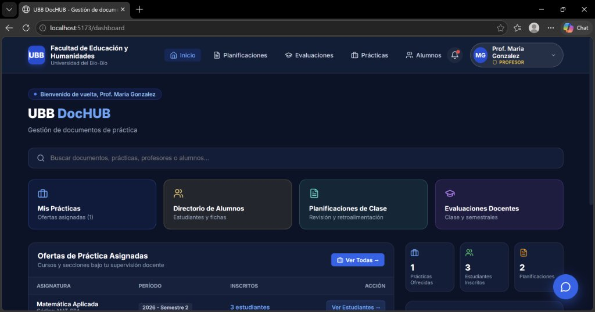
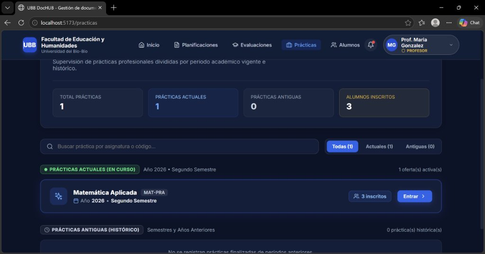
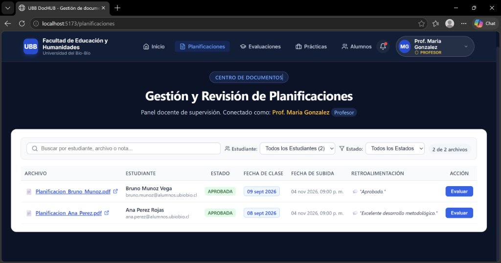
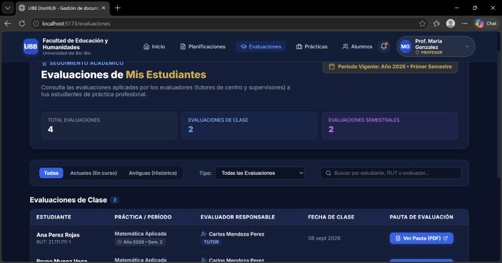

# 🎓 UBB DocHUB — Gestor de Prácticas Profesionales (Pedagogía en Educación Matemática)

---

## 📸 Vista General del Sistema (Módulos Principales)

### 1. Panel Principal Docente (`/dashboard`)
El **Dashboard de Inicio** ofrece al profesor supervisor una vista centralizada de toda su carga académica y documental:
- **Buscador global:** Permite localizar rápidamente documentos, prácticas, profesores o alumnos.
- **Accesos rápidos:** Tarjetas interactivas hacia *Mis Prácticas*, *Directorio de Alumnos*, *Planificaciones de Clase* y *Evaluaciones Docentes*.
- **Ofertas de Práctica Asignadas:** Resumen de las asignaturas y secciones bajo supervisión del docente (ej. *Matemática Aplicada — `MAT-PRA`*) con acceso directo al listado de estudiantes inscritos.
- **Indicadores en tiempo real:** Resumen estadístico de prácticas ofrecidas, estudiantes inscritos y planificaciones recibidas.



---

### 2. Supervisión de Prácticas Profesionales (`/practicas`)
Módulo dedicado a la administración de ofertas de práctica divididas por período académico:
- **Métricas de seguimiento:** Contadores de *Total Prácticas*, *Prácticas Actuales*, *Prácticas Antiguas* y *Alumnos Inscritos*.
- **Filtros por período y búsqueda:** Permite alternar entre prácticas **Actuales (En curso)** y **Antiguas (Histórico de semestres anteriores)**, además de filtrar por nombre de asignatura o código.
- **Acceso al detalle de cada oferta:** Visualización de los practicantes inscritos, sus centros de práctica asignados e informes asociados.



---

### 3. Centro de Documentos: Gestión y Revisión de Planificaciones (`/planificaciones`)
Espacio donde el profesor guía supervisa y evalúa el material pedagógico elaborado por los estudiantes en práctica:
- **Listado de entregas en PDF:** Acceso directo a los documentos de planificación subidos por cada estudiante (con fecha programada de clase y marca de tiempo de subida).
- **Filtros combinados:** Búsqueda por nombre de estudiante, nombre de archivo o nota, junto con selectores por **Estudiante** y por **Estado** (`APROBADA`, `PENDIENTE`, `RECHAZADA`).
- **Retroalimentación y Evaluación:** Permite al docente registrar observaciones metodológicas detalladas y cambiar el dictamen de cada planificación mediante el botón **Evaluar**.



---

### 4. Seguimiento Académico: Evaluaciones de Estudiantes (`/evaluaciones`)
Módulo de consulta de las evaluaciones aplicadas en los establecimientos educacionales por los **Evaluadores** (*Tutores de centro de práctica* y *Colaboradores/Supervisores*):
- **Resumen cuantitativo:** Tarjetas con el desglose de *Total Evaluaciones*, *Evaluaciones de Clase* y *Evaluaciones Semestrales*.
- **Filtros avanzados:** Filtrado por período (*Todas*, *Actuales en curso*, *Histórico*), por tipo de evaluación y buscador por estudiante, RUT o evaluador responsable.
- **Descarga y visualización de pautas:** Acceso directo al documento oficial en PDF (**Ver Pauta (PDF)**) asociado a cada sesión evaluada.



---

## 🛠️ Tecnologías Utilizadas

El proyecto implementa una arquitectura moderna **Cliente-Servidor desacoplada** y completamente contenerizada:

### ☕ Backend (`backend/`)
| Tecnología | Versión | Propósito en el Proyecto |
| :--- | :--- | :--- |
| **Java (Eclipse Temurin)** | `17 LTS` | Lenguaje base tipado y orientado a objetos para la lógica de negocio. |
| **Spring Boot** | `3.2.3` | Framework principal para la construcción de la API RESTful (`com.ubb.dochub`). |
| **Spring Web** | `3.2.3` | Exposición de controladores REST, manejo de peticiones HTTP y carga/descarga de archivos PDF (`multipart/form-data`). |
| **Spring Data JPA / Hibernate** | `3.2.3` | Mapeo Objeto-Relacional (ORM), repositorios transaccionales (`@Transactional`) y consultas JPQL. |
| **Spring Security** | `3.2.3` | Control de acceso basado en roles (RBAC), configuración de políticas CORS y encriptación de contraseñas con **BCrypt**. |
| **Jakarta Validation** | `3.2.3` | Validación declarativa de DTOs (`@NotBlank`, `@Email`, `@Size`). |
| **Lombok** | `1.18.x` | Reducción de código repetitivo en entidades y objetos de transferencia. |
| **Maven** | `3.9` | Gestión de dependencias y empaquetado del artefacto ejecutable `.jar`. |

### ⚛️ Frontend (`frontend/`)
| Tecnología | Versión | Propósito en el Proyecto |
| :--- | :--- | :--- |
| **React** | `18.2` | Biblioteca de interfaz de usuario basada en componentes reactivos y Hooks (`useState`, `useEffect`, `useContext`). |
| **TypeScript** | `5.2` | Tipado estático de interfaces de dominio, respuestas de API y propiedades de componentes. |
| **Vite** | `5.1` | Empaquetador ultrarrápido con Hot Module Replacement (HMR) para desarrollo y optimización de bundle en producción. |
| **React Router DOM** | `6.22` | Enrutamiento SPA del lado del cliente y protección de vistas según el rol del usuario (`ProtectedRoute`). |
| **Axios** | `1.6.8` | Cliente HTTP asíncrono para la comunicación con los endpoints del backend. |
| **Lucide React** | `0.344` | Sistema de iconografía vectorial consistente en toda la interfaz. |
| **Sonner** | `1.4.3` | Sistema de notificaciones emergentes (*toast*) para retroalimentación inmediata al usuario. |
| **Nginx** | `Alpine` | Servidor web en producción encargado de servir el bundle estático, manejar rutas SPA y actuar como *reverse proxy* hacia `/api/` (con soporte de subidas de hasta `50MB`). |

### 🗄️ Base de Datos e Infraestructura
| Tecnología | Versión | Propósito en el Proyecto |
| :--- | :--- | :--- |
| **MySQL** | `8.0` | Motor de base de datos relacional principal en producción con soporte transaccional ACID. |
| **H2 Database** | `Runtime` | Base de datos en memoria para pruebas unitarias y desarrollo local ligero. |
| **phpMyAdmin** | `Latest` | Interfaz web para administración e inspección directa de las tablas MySQL (`:8081`). |
| **Docker & Docker Compose** | `v2` | Orquestación multi-contenedor (`db`, `backend`, `frontend`, `phpmyadmin`), red puente aislada (`dochub-network`) y volúmenes persistentes para datos y archivos PDF (`mysql_data`, `uploads_data`). |

---

## 📂 Estructura del Proyecto

```text
.
├── backend/                              # API REST Spring Boot 3 (Java 17)
│   ├── Dockerfile                        # Build multi-etapa (Maven -> JRE Alpine)
│   ├── pom.xml                           # Configuración y dependencias Maven
│   └── src/main/java/com/ubb/dochub/
│       ├── config/                       # Seguridad CORS, BCrypt y DataInitializer (semillas)
│       ├── controller/                   # Controladores REST (Prácticas, Planificaciones, Evaluaciones, Auth)
│       ├── dto/                          # Objetos de transferencia de datos validados
│       ├── entity/                       # Entidades JPA (Oferta, Inscripcion, Planificacion, Clase, etc.)
│       ├── repository/                   # Interfaces Spring Data JPA
│       └── service/                      # Lógica de negocio y almacenamiento de archivos
│
├── frontend/                             # Aplicación SPA React + TypeScript + Vite
│   ├── Dockerfile                        # Build multi-etapa (Node 20 -> Nginx Alpine)
│   ├── nginx.conf                        # Configuración de proxy inverso (/api/) y SPA fallback
│   └── src/
│       ├── components/                   # Vistas y componentes modulares (PlanificacionesView, Navbar, etc.)
│       ├── context/                      # Estado global de sesión y rol (AuthContext.tsx)
│       ├── pages/                        # Páginas principales de la aplicación
│       └── services/                     # Configuración de cliente Axios (api.ts)
│
├── docs/screenshots/                     # Capturas de pantalla de la documentación
└── docker-compose.yml                    # Orquestación de los 4 servicios en contenedores
```

---

## 🚀 Instalación y Ejecución con Docker (Recomendado)

### 1. Clonar el repositorio
```bash
git clone https://github.com/boriskb24/Gestor-de-pr-cticas-ubb-pedagog-a-matem-tica.git
cd Gestor-de-pr-cticas-ubb-pedagog-a-matem-tica
```

### 2. Construir y levantar los contenedores
```bash
docker compose up --build -d
```

### 3. Accesos a la plataforma
- **Aplicación Web (Frontend):** [http://localhost:5173](http://localhost:5173)
- **API Backend (Spring Boot):** [http://localhost:8080](http://localhost:8080)
- **Administrador de BD (phpMyAdmin):** [http://localhost:8081](http://localhost:8081) *(Usuario: `root` | Contraseña: `password123`)*

---

## 🔑 Usuarios de Prueba Precargados (`DataInitializer`)

Al iniciar el sistema, el componente `DataInitializer` poblará automáticamente la base de datos con asignaturas, ofertas, inscripciones, planificaciones y evaluaciones de ejemplo:

| Rol | Nombre | Correo Electrónico | Contraseña | Datos de Prueba Asociados |
| :--- | :--- | :--- | :--- | :--- |
| **Profesor** | Prof. María González | `maria.gonzalez@ubiobio.cl` | `password123` | *Matemática Aplicada (`MAT-PRA`)* — 3 estudiantes, 2 planificaciones y 4 evaluaciones. |
| **Profesor** | Prof. Boris Arenas | `boris.profe@ubiobio.cl` | `password123` | *Práctica Profesional I y II* — 5 estudiantes y planificaciones en distintos estados. |
| **Profesor** | Prof. Juan Pérez | `profesor@ubiobio.cl` | `password123` | *Práctica Profesional I (Histórico 2025-2)*. |
| **Evaluador** | Ing. Carlos Mendoza | `evaluador@empresa.cl` | `password123` | Tutor de centro con evaluaciones de clase y semestrales asignadas. |
| **Estudiante** | Ana Pérez Rojas | `ana.perez@alumnos.ubiobio.cl` | `password123` | Estudiante inscrita en *Matemática Aplicada* con planificación e historial de evaluación. |
| **Administrador** | Prof. Boris Arenas | `admin@ubiobio.cl` | `12345678b` | Gestión general del sistema. |
